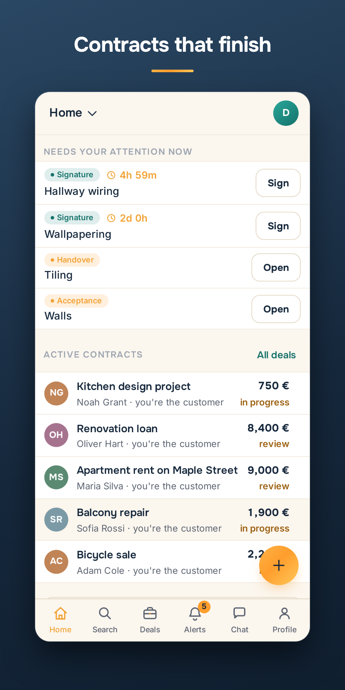
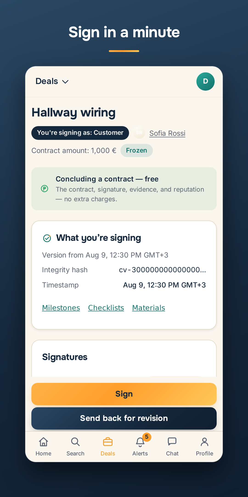
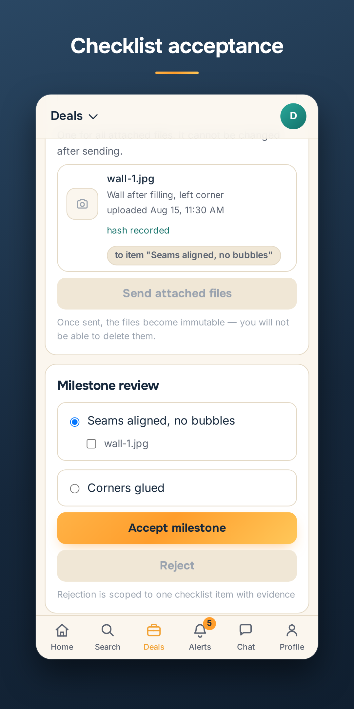
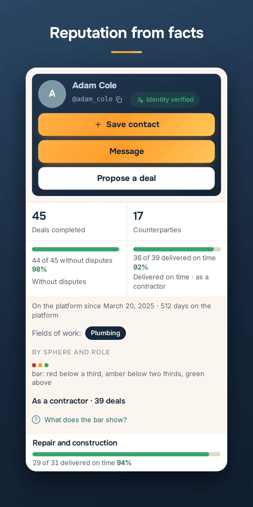

# Porukam

Porukam («По рукам») is a platform for contracts between people and businesses. It covers a legally significant contract, milestones with acceptance checklists, payments made directly between the parties, evidence of the work, and a reputation card built from completed contracts.

**Porukam is free to use.** The platform does not charge for concluding contracts or for payments, and it does not hold the parties' funds.

Developed by [Trust Dev](https://trust-dev.com/).

<p>
  
  
  
  
</p>

## Links

- Website: https://porukam.app/
- Google Play: https://play.google.com/store/apps/details?id=porukam.app
- Developer: https://trust-dev.com/
- Privacy policy: https://porukam.app/legal/privacy
- Terms of service: https://porukam.app/legal/terms

The legal texts are published on the website only and are not part of this repository.

## Stack and architecture

- Backend: Python 3.12, Django 5.2 LTS, Django REST Framework 3.16, Celery, PostgreSQL 16, Redis 7.
- Frontend: React 18.3, TypeScript 5.6, Vite 5.4; npm workspaces (`web/`, `packages/core`, `packages/ui`, `packages/i18n`).
- Modular monolith: each Django app is a bounded context with the layers `api/` → `services.py` → `selectors.py` → `models.py`. Apps talk through service facades and domain events (transactional outbox), not through each other's models. `import-linter` enforces the boundaries.
- Audit Vault is a separate process with its own append-only database and a hash chain.

See [docs/en/architecture.md](docs/en/architecture.md) for a one-page overview.

## Run locally

Requirements: Docker, [uv](https://docs.astral.sh/uv/), Node.js 18 or newer (CI uses 20).

```bash
cp backend/.env.example backend/.env     # set your own local secrets, see the comments inside
make up                                  # PostgreSQL (x2), Redis (x2), MinIO, Mailhog, monitoring
cd backend && uv sync && cd ..
make migrate
make run                                 # API on http://localhost:8000

npm ci                                   # at the repository root
npm run dev                              # web app on http://localhost:5173 (mock API by default)
```

The web app uses a mock API unless it is built with `VITE_API_MODE=real`.

The application image builds from `infra/docker/app/Dockerfile`; in this repository `BASE_IMAGE` defaults to the public `python:3.12-slim`.

## Tests and lint

```bash
make test                                # backend: pytest (needs the PostgreSQL service from `make up`)
make lint                                # ruff, mypy (strict), import-linter
npm test                                 # frontend: vitest
npm run typecheck
npm run lint:terms && npm run lint:i18n
```

## Documentation

Detailed specifications and architecture decision records (`docs/`) are written in Russian. Some code comments and ADRs reference internal documents that are not published. In English there are an [architecture overview](docs/en/architecture.md), a [glossary](docs/en/glossary.md) and an [ADR index](docs/en/adr-index.md).

## Contributing and security

Pull requests are welcome; see [CONTRIBUTING.md](CONTRIBUTING.md). Commits need a DCO sign-off. Report vulnerabilities privately, see [SECURITY.md](SECURITY.md).

## License

[Apache License 2.0](LICENSE). Third-party notices are in [NOTICE](NOTICE).
